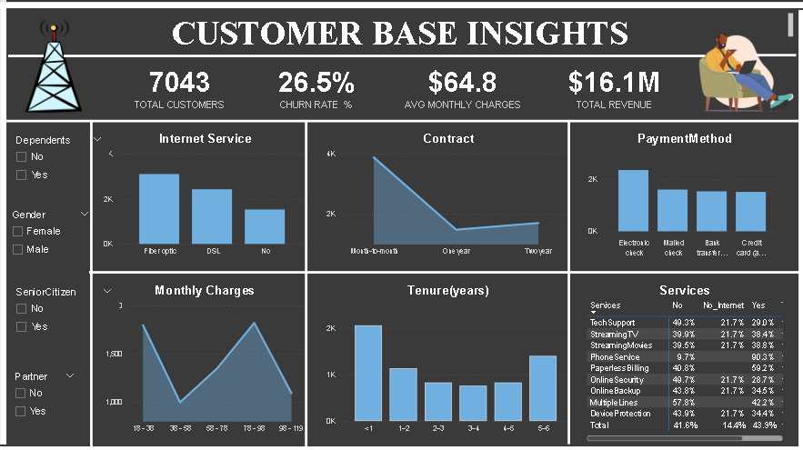
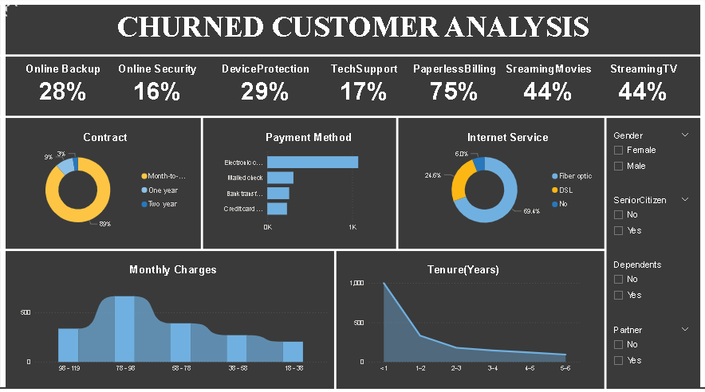

<div align="center">

# 📡 Telecom Customer Churn Analysis

### *Why do customers leave, and what can we do about it?*

An end-to-end analytics project using **SQL Server**, **Power BI** and **Excel** on 7,043 telecom customers.

<br>


<br>

| 👥 Customers | 📉 Churn Rate | 💳 Avg. Monthly Charge | 💰 Total Revenue |
|:---:|:---:|:---:|:---:|
| **7,043** | **26.5%** | **$64.8** | **$16.1M** |

</div>

---

## 📑 Table of Contents

- [🎯 Project Objectives](#-project-objectives)
- [🗂 Dataset](#-dataset)
- [🛠 Tech Stack & Workflow](#-tech-stack--workflow)
- [🖼 Dashboard Previews](#-dashboard-previews)
- [🔍 Key Insights](#-key-insights)
- [💡 Recommendations](#-recommendations)
- [📁 Repository Structure](#-repository-structure)
- [🚀 How to Use](#-how-to-use)
- [✅ Conclusion](#-conclusion)

---

## 🎯 Project Objectives

- 🔎 Identify patterns that separate **churned** from **retained** customers
- 📊 Understand the main **drivers of churn**
- 🧭 Recommend **data-backed strategies** to improve retention
- 🖥 Build an **interactive Power BI dashboard** for business stakeholders

---

## 🗂 Dataset

Sourced from **Kaggle**: **7,043 rows × 23 columns**, one row per customer.

| Category | Columns |
|---|---|
| 🧑 **Demographics** | `gender`, `SeniorCitizen`, `Partner`, `Dependents` |
| 📞 **Services** | `PhoneService`, `MultipleLines`, `InternetService`, `OnlineSecurity`, `OnlineBackup`, `DeviceProtection`, `TechSupport`, `StreamingTV`, `StreamingMovies` |
| 💵 **Billing & Contract** | `tenure`, `Contract`, `PaperlessBilling`, `PaymentMethod`, `MonthlyCharges`, `TotalCharges` |
| 🎫 **Support** | `numAdminTickets`, `numTechTickets` |
| 🎯 **Target** | `Churn` (Yes / No) |

---

## 🛠 Tech Stack & Workflow


<details>
<summary><b>🔹 SQL Server: data cleaning & exploration</b></summary>

<br>

- Created the `TEL_CHURN` database and imported the raw dataset
- Built staging and cleaned tables
- Converted problematic data types (e.g. `BIT` → `VARCHAR`)
- Handled missing values. `TotalCharges` nulls were replaced with `0`:

```sql
-- Check for missing TotalCharges
SELECT COUNT(*) 
FROM [RAW DATA EXCEL]
WHERE TotalCharges IS NULL;

-- Replace nulls with 0
UPDATE [RAW DATA EXCEL]
SET TotalCharges = 0
WHERE TotalCharges IS NULL;
```

- Ran exploratory queries: distribution checks, churn segmentation, revenue analysis

> 📝 *Not all queries are uploaded to this repository.*

</details>

<details>
<summary><b>🔹 Power BI: modelling & visualisation</b></summary>

<br>

- Imported the cleaned SQL data
- Transformations: binary replacements, grouping ranges (tenure & monthly charges), unpivoting service columns
- Created DAX measures: **Churn Rate**, **Retention Rate**, **Revenue metrics**
- Built **two dashboards**: Overall Customer Base and Churned Customers

</details>

<details>
<summary><b>🔹 Excel: validation</b></summary>

<br>

- Preliminary checks and dataset validation before loading into SQL Server

</details>

---

## 🖼 Dashboard Previews

### 1️⃣ Customer Base Insights (Overall)

<p align="center">
  
</p>

### 2️⃣ Churned Customer Analysis

<p align="center">
  
</p>

> 🎛 Both dashboards include slicers for **Gender**, **Senior Citizen**, **Dependents** and **Partner**.

---

## 🔍 Key Insights

| # | Finding |
|:-:|---|
| 1️⃣ | **Fiber Optic** users make up about **69%** of churned customers, and **Electronic Check** is the most common payment method among them |
| 2️⃣ | **Month-to-month contracts** account for about **89%** of churn, while 1-year and 2-year contracts retain far better |
| 3️⃣ | Churn is heavily concentrated in the **first year of tenure** (`< 1 year`) |
| 4️⃣ | **Gender is not a meaningful factor**: churn is similar for male and female customers |
| 5️⃣ | Customers with **partners or dependents** and those on **Credit Card auto-pay** are less likely to churn |
| 6️⃣ | Among churned customers, adoption of **Online Security (16%)**, **Tech Support (17%)**, **Online Backup (28%)** and **Device Protection (29%)** is low |

### 📌 Churned Customer Profile at a Glance

| Feature | Share of Churned Customers |
|---|:---:|
| Paperless Billing | 75% |
| Streaming TV | 44% |
| Streaming Movies | 44% |
| Device Protection | 29% |
| Online Backup | 28% |
| Tech Support | 17% |
| Online Security | 16% |

---

## 💡 Recommendations

<table>
<tr>
<td width="50%" valign="top">

### 🌐 Service Quality
- Address **speed, downtime and pricing** issues on Fiber Optic plans
- Offer **loyalty discounts** and **bundled add-ons** to fiber customers

### 💳 Payment Optimisation
- Move customers from **Electronic Check** to **auto-pay** (Bank Transfer, Credit Card)
- Reward auto-pay with discounts, cashback or points

### 📝 Contracts & Retention
- Promote **1-year / 2-year contracts** with discounts or bundles
- Highlight **family-friendly benefits** such as multi-device access

</td>
<td width="50%" valign="top">

### 🛡 Service Adoption
- Run awareness campaigns for **Security, Backup and Device Protection**
- Offer **free 1–3 month trials**
- Bundle these services at **discounted rates** with internet and phone plans

### 🎧 Customer Support
- Train support teams to **upsell retention-related services** during at-risk interactions

</td>
</tr>
</table>

---

## 📁 Repository Structure

```
📦 telecom-churn-analysis
 ┣ 📂 data
 ┃ ┗ 📄 RAW_DATA.xlsx
 ┣ 📂 sql
 ┃ ┣ 📄 SQLQuery1.sql        # Database creation
 ┃ ┗ 📄 SQLQuery2.sql        # Null checks & cleaning
 ┣ 📂 powerbi
 ┃ ┗ 📄 DASHBOARDS.pbix
 ┣ 📂 images
 ┃ ┣ 🖼 CUSTOMER_DASHBOARD.png
 ┃ ┗ 🖼 CHURNED_CUSTOMER.png
 ┗ 📄 README.md
```

---

## 🚀 How to Use

1. **Download or clone this repository** (green **Code** button at the top of the page)
2. **Explore the data**: open `data/RAW_DATA.xlsx`
3. **Run the SQL scripts** in SQL Server Management Studio (in order: `SQLQuery1.sql`, then `SQLQuery2.sql`)
4. **Open the dashboard**: load `powerbi/DASHBOARDS.pbix` in [Power BI Desktop](https://powerbi.microsoft.com/desktop/)

---

## ✅ Conclusion

**26.5% of customers churn**, and the problem is concentrated among **new, month-to-month, Fiber Optic customers paying by Electronic Check** who rarely use protection and support add-ons.

Improving fiber service quality, pushing auto-pay, encouraging longer contracts and increasing add-on adoption can meaningfully **reduce churn, protect revenue and build long-term loyalty**.

---

<div align="center">

⭐ *If you found this project useful, consider giving it a star!*

</div>
